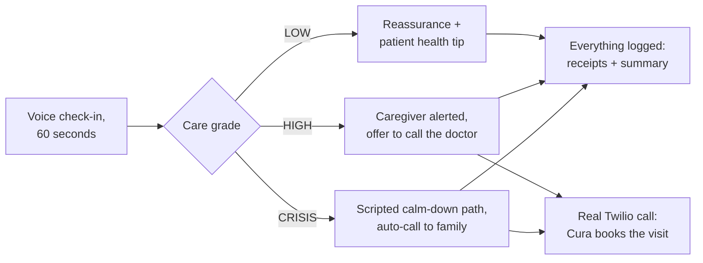

<div align="center">


[](https://nextspakhacks.devpost.com)
[](https://nextjs.org)
[](https://ai.google.dev)
[](https://www.twilio.com/voice)
[](https://supabase.com)
[](#-stack)

**A voice-first AI care companion.** One minute of honest conversation every
day — and when something's off, Cura is the one who speaks up, logs everything,
and makes the phone calls that matter.

**[▶ Open the live demo](https://cura-king4rishiths-projects.vercel.app)**

</div>

<br>

## The story

The care system sees your parent twice a month. The person who actually knows
how last night went — the dizziness, the skipped pills, the rough night — is
nobody, because daily check-ins are a human's job, and humans get busy, forget,
or live three time zones away.

**Cura does the daily part.** She calls out on the speakerphone, asks how things
are in plain language, listens with care, and answers out loud — in her own
Gemini-generated voice, not a robotic browser voice. Every conversation ends
with a **grade** and visible **receipts**: exactly what Cura did, and why.

> **Our goal: no quiet bad days.** If something is wrong, it becomes a
> notification, a receipt, and a booked appointment — before dinner, not after
> the next scheduled visit.

<br>

## How a conversation flows



- **LOW** — a good day. Cura keeps it warm and short.
- **HIGH** — something's off. The caregiver gets a `notify_caregiver` receipt
  and the patient console offers (consent-first) a real phone call to the
  doctor's office, where Cura speaks to a human receptionist in conversation.
- **CRISIS** — dangerous wording routes to a fully **deterministic** path:
  scripted, calm, and the agent has no say in it.

<br>

## What's under the hood

| Layer | How it works |
|---|---|
| **Agent loop** | Gemini tool-calling, with a **tier guard**: proposed crisis actions are downgraded unless the check-in itself graded CRISIS |
| **Voice in** | Web Speech recognition, push-to-talk orb |
| **Voice out** | Gemini native TTS (`gemini-2.5-flash-preview-tts`, voice *Aoede*) → WAV → `<audio>`; browser `speechSynthesis` only as fallback |
| **Phone calls** | Twilio Programmable Voice — hand-built TwiML, a `<Gather>` loop that lets the receptionist talk back |
| **Records** | Supabase: check-ins, grades, receipts, calls, notifications |
| **Design** | "Organic" system — earth palette, Source Serif 4 + Instrument Sans, paper grain, animated but screen-reader-safe |

<br>

## The safety rails

- **Cura never dials 911.** Emergency escalation is a human decision — Cura's
  job is making the right humans know quickly and clearly.
- The agent **cannot** self-promote a crisis: a tier guard checks its proposals
  against the deterministic grade each turn.
- Receipts are the contract: every action Cura takes is visible to the patient
  push-style, and to the family in the dashboard. Nothing happens silently.
- Not medical advice. A companion, not a clinician.

<br>

## Stack

Next.js 16 · TypeScript · Tailwind · Gemini agent + native TTS · Twilio Voice ·
Supabase · Web Speech API · hand-built TwiML. Everything runs on **free tiers**
— the point of a companion is that anyone could run it.

```bash
git clone https://github.com/justrishith/cura
cd cura
npm install
# .env.local — Gemini, Supabase, Twilio creds
npm run dev
```

<br>

<div align="center">

Built end-to-end in one weekend by **[Rishith](https://github.com/justrishith)**
for **NextSpark Hacks**.

</div>
